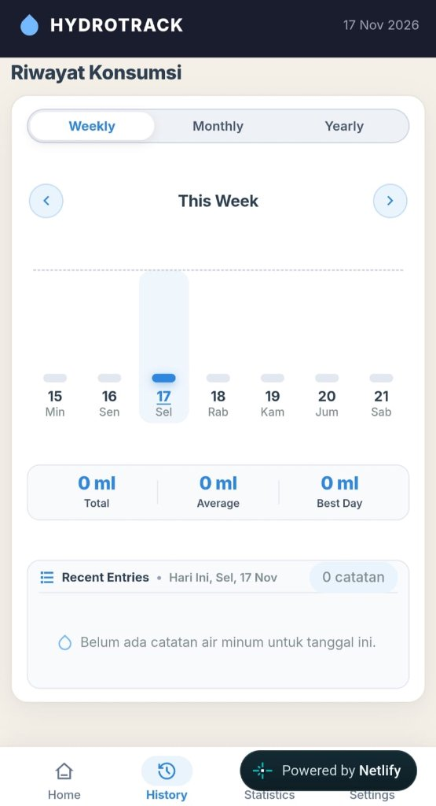

# 💧 HydroTrack — Daily Water Intake Tracker

**HydroTrack** adalah aplikasi web pelacak konsumsi air harian (*Daily Water Intake Tracker*) yang dirancang untuk membantu pengguna mencatat asupan cairan, mencapai target hidrasi harian, dan memantau kebiasaan minum melalui visualisasi data interaktif.

Proyek ini dibangun menggunakan **HTML5**, **CSS3 Murni (Custom Properties, Flexbox, Grid)**, dan **Vanilla JavaScript (ES6+)** tanpa *framework* CSS/JS eksternal, dengan penyimpanan data lokal berbasis `localStorage`.

---

## ✨ Fitur Utama

### 1. 🏠 Home (Dashboard Utama — `index.html`)
- **Progress Target Harian:** Menampilkan total konsumsi cairan hari ini dibandingkan target harian (`ml` dan persentase `%`) melalui *progress bar* dinamis.
- **Quick Log Menu Minuman & Wadah Kustom:**
  - Pilihan kategori minuman (*Water*, *Coffee*, *Tea*, *Milk*, *Fruit Juice*, *Energy Drink*, *Sports Drink*, *Soft Drink*, *QRS*, atau tambah kategori minuman baru).
  - Tombol takaran cepat (*Coffee Cup 100 ml*, *Tea Cup 150 ml*, *Small Cup 175 ml*, *Medium Glass 200 ml*, *Large Glass 300 ml*, *Water Bottle 500 ml*, *Large Bottle 1.000 ml*) serta fitur **+ Add Container** untuk membuat ukuran wadah sendiri.
- **Visualisasi Botol Hidrasi Interaktif:** Animasi ketinggian air dan gelombang di dalam botol yang naik secara *real-time* mengikuti persentase capaian target.
- **Recent Entries (Catatan Hari Ini):** Daftar riwayat minum hari ini lengkap dengan fitur **Edit** (ubah wadah, jenis minuman, jam, volume) dan **Delete** langsung di tempat.
- **Floating Action Button (FAB Speed Dial):** Jalan pintas cepat untuk menambahkan *New Beverage*, *New Container*, dan *+ Add Custom Intake*.

### 2. 📅 History (Riwayat Konsumsi — `riwayat.html`)
- **3 Mode Rentang Waktu Interaktif:**
  - **Weekly:** Grafik batang 7 hari dengan garis batas target dan lencana trofi (🏆) saat target harian tercapai.
  - **Monthly:** Kalender bulanan interaktif dengan penanda hari aktif dan hari yang mencapai target.
  - **Yearly:** *Heatmap* kontribusi 365 hari dalam setahun dengan 4 tingkatan intensitas warna.
- **Ringkasan 3 Metrik Utama:** Menampilkan *Total Intake*, *Average*, *Best Day*, *Days Tracked*, *Goals Met*, dan *Success Rate* sesuai periode yang dipilih.
- **Rincian Catatan Per Tanggal:** Klik tanggal mana pun pada grafik/kalender untuk melihat, mengedit, atau menghapus catatan minum pada tanggal tersebut.

### 3. 📊 Statistics (Analisis & Statistik — `analisis.html`)
- **4 Kartu Ringkasan Utama:** *Total Intake*, *Daily Average*, *Success Rate*, dan *Days Tracked*.
- **Overview Kebiasaan Hidrasi (8 Metrik):** *Current Streak*, *Success Rate*, *Days Tracked*, *Average Interval*, *Average Drink Size*, *Largest Drink*, *First Drink*, dan *Last Drink*.
- **Beverage Breakdown:** Grafik *Doughnut* (Chart.js) dan daftar persentase distribusi jenis minuman yang dikonsumsi.
- **Container Usage:** Tabel statistik frekuensi dan persentase penggunaan masing-masing wadah minum (*Container*, *Volume*, *Uses*).

### 4. ⚙️ Settings (Pengaturan & Profil — `pengaturan.html`)
- **Profile & Daily Goals:**
  - Kartu profil terpadu yang menampilkan sapaan waktu otomatis, nama pengguna, serta 3 metrik cepat (*Today's Entries*, *Days Tracked*, *Today's Goal*).
  - Pengaturan **Personal** (*Nama Pengguna* & *Gender*: *Male*, *Female*, *Prefer not to say*).
  - Pengaturan **Daily Goals** (*Daily Water Goal* dengan pilihan cepat `1.5 L`–`3 L` & *Activity Level*: *Sedentary* hingga *Very Active*).
- **Appearance (Tema Tampilan):** Pilihan mode **System** (mengikuti tema perangkat), **Light** (mode terang), dan **Dark** (mode gelap kontras tinggi berstandar WCAG AA).
- **Data Management:**
  - **Export as CSV:** Unduh seluruh riwayat catatan minum ke dalam file `.csv` untuk dibuka di Microsoft Excel atau Google Sheets.
  - **Delete Data:** Opsi *Delete entries before date* (hapus catatan sebelum tanggal tertentu), *Delete local data only* (hapus riwayat tanpa menghapus profil), dan *Delete everything* (reset penuh ke pengaturan awal).
- **About & Contributors:** Informasi versi aplikasi, teknologi yang digunakan, dan daftar tim pengembang.

---

## 🚀 Cara Menjalankan Aplikasi

Aplikasi ini berjalan sepenuhnya di sisi klien (*client-side*) dan tidak memerlukan instalasi *database* atau *backend server*.

### Opsi 1: Buka Langsung di Browser
1. **Clone** atau unduh repositori ini:
   ```bash
   git clone https://github.com/Chief123-cod/hydrotrack.git
   cd hydrotrack
   ```
2. Klik dua kali file `index.html` untuk membukanya langsung di browser (Google Chrome, Microsoft Edge, Firefox, atau Safari).

### Opsi 2: Menggunakan VS Code Live Server (Disarankan)
1. Buka folder `hydrotrack` di **Visual Studio Code**.
2. Pasang ekstensi **Live Server** (oleh Ritwick Dey).
3. Klik kanan pada `index.html` lalu pilih **"Open with Live Server"**.
4. Aplikasi akan terbuka otomatis di `http://127.0.0.1:5500/index.html`.

### Opsi 3: Menggunakan Terminal (Python / Node.js)
```bash
# Menggunakan Python 3
python -m http.server 8080

# Atau menggunakan Node.js
npx serve .
```
Kemudian buka `http://localhost:8080` di browser Anda.

---

## 🖼️ Screenshot Aplikasi

> Letakkan file gambar tangkapan layar aplikasi Anda pada folder `assets/screenshots/` sesuai nama file di bawah ini agar tampil otomatis di halaman GitHub.

### Tampilan Desktop
| Home (`index.html`) | History (`riwayat.html`) |
| :---: | :---: |
|  |  |

| Statistics (`analisis.html`) | Settings (`pengaturan.html`) |
| :---: | :---: |
|  |  |

### Tampilan Mobile (Responsive)
| Home Mobile | History Mobile | Statistics Mobile | Settings Mobile |
| :---: | :---: | :---: | :---: |
|  |  |  |  |

---

## 📂 Struktur Direktori

```text
hydrotrack/
├── index.html          # Halaman utama (Dashboard, Quick Log, Botol Hidrasi, Recent Entries)
├── riwayat.html        # Halaman riwayat (Weekly Bar, Monthly Calendar, Yearly Heatmap)
├── analisis.html       # Halaman statistik (Overview 8 Metrik, Beverage Breakdown, Container Usage)
├── pengaturan.html     # Halaman pengaturan (Profile, Appearance, Data Management, About)
├── css/
│   ├── style.css       # Variabel CSS global (Light & Dark Mode), reset, sidebar, bottom-nav
│   ├── components.css  # Styling komponen kartu, botol, tabel, grafik, modal, dan form
│   └── responsive.css  # Media queries untuk Desktop, Tablet (<= 1024px, <= 768px), dan Mobile (<= 640px)
├── js/
│   ├── storage.js      # Manajemen data LocalStorage (CRUD log minum, wadah, pengaturan, ekspor CSV)
│   ├── ui.js           # Manipulasi DOM, rendering komponen, kalkulasi metrik, modal, dan toast
│   ├── chart.js        # Konfigurasi dan pembaruan grafik Chart.js (Doughnut & Bar Chart)
│   └── app.js          # Event listener utama, navigasi, drag-to-scroll, dan kontrol interaksi
└── docs/
    ├── PRD.md          # Dokumen Spesifikasi Kebutuhan Produk
    └── WORKFLOW.md     # Standar Operasional Prosedur Pengembangan
```

---

## 🛠️ Teknologi yang Digunakan

- **HTML5 Semantik** (`<header>`, `<aside>`, `<nav>`, `<main>`, `<section>`)
- **CSS3 Murni** (*CSS Custom Properties*, *Flexbox*, *CSS Grid*, *Media Queries*, *Keyframe Animations*)
- **Vanilla JavaScript (ES6+)** (*Modular IIFE Pattern*, *DOM Manipulation*, *LocalStorage API*, *Blob CSV Export*)
- **[Chart.js v4.4.7](https://www.chartjs.org/)** — Visualisasi grafik proporsi minuman
- **[Remix Icon v4.6.0](https://remixicon.com/)** — Ikonografi antarmuka
- **[Google Fonts (Inter)](https://fonts.google.com/specimen/Inter)** — Tipografi utama

---

## 👥 Tim Pengembang (Contributors)

1. **Pontoh, Faith** — *Project Lead & UI/UX Designer*
2. **Jose Angelo Raphael Ratumbanua** — *Frontend & Core Logic Developer*
3. **Camelia Anggreita Tumimomor** — *Interface Design & Analytics*
4. **Seril Sevanya Wanta** — *Responsive Layout & QA Specialist*
