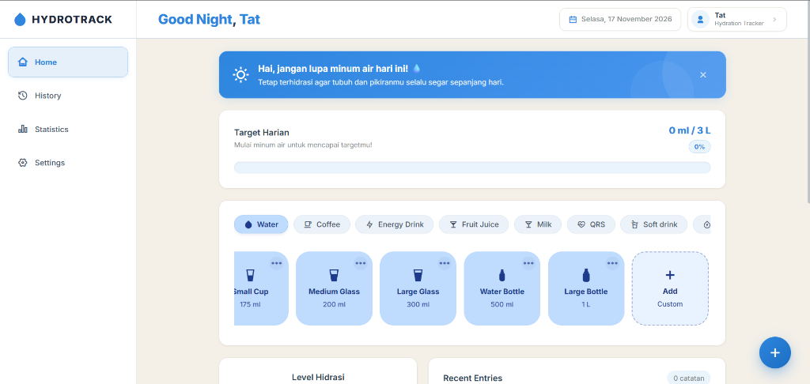
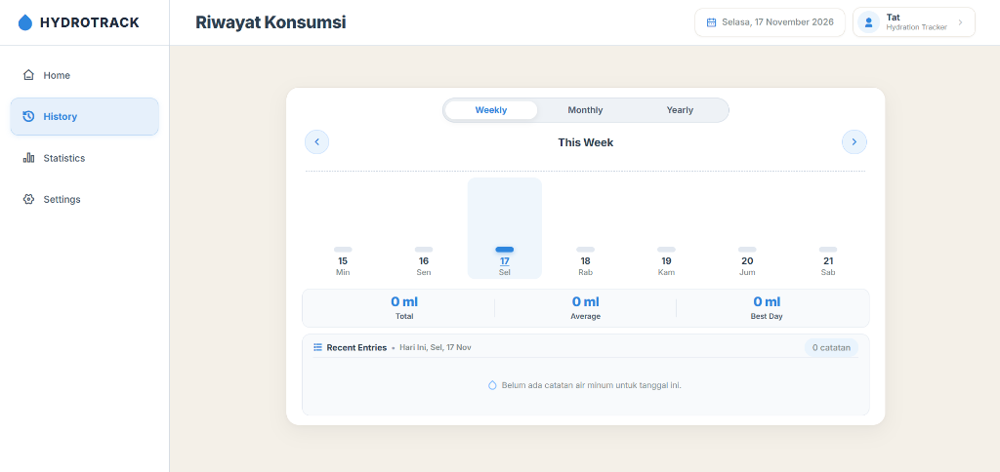
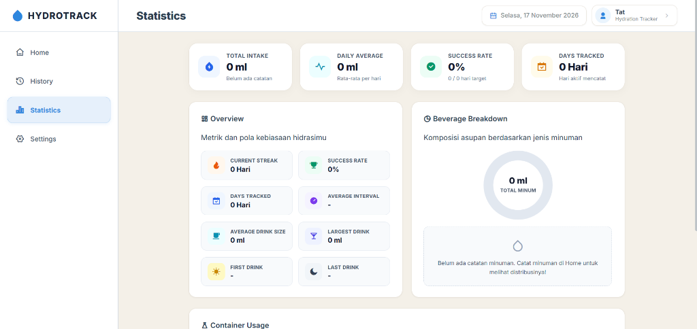
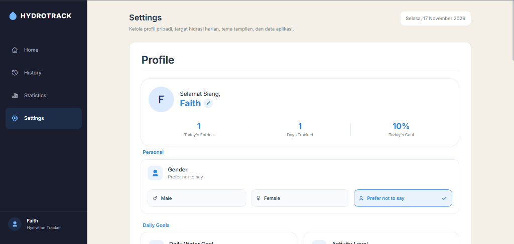
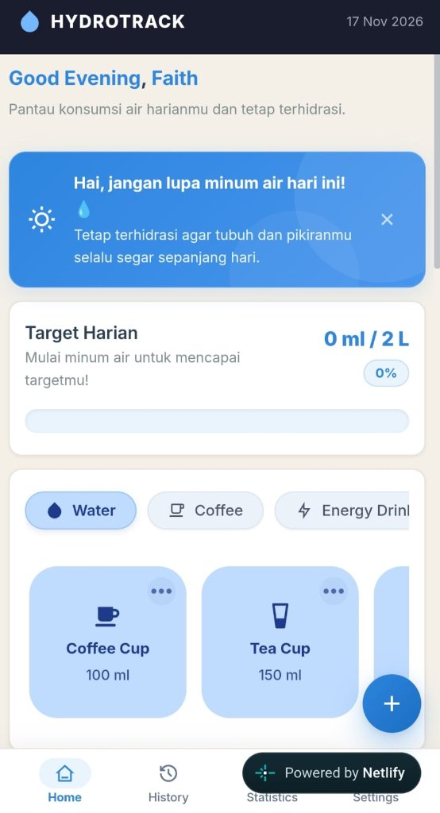
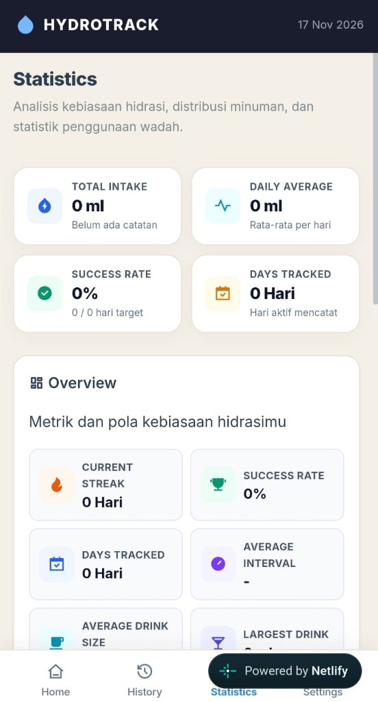
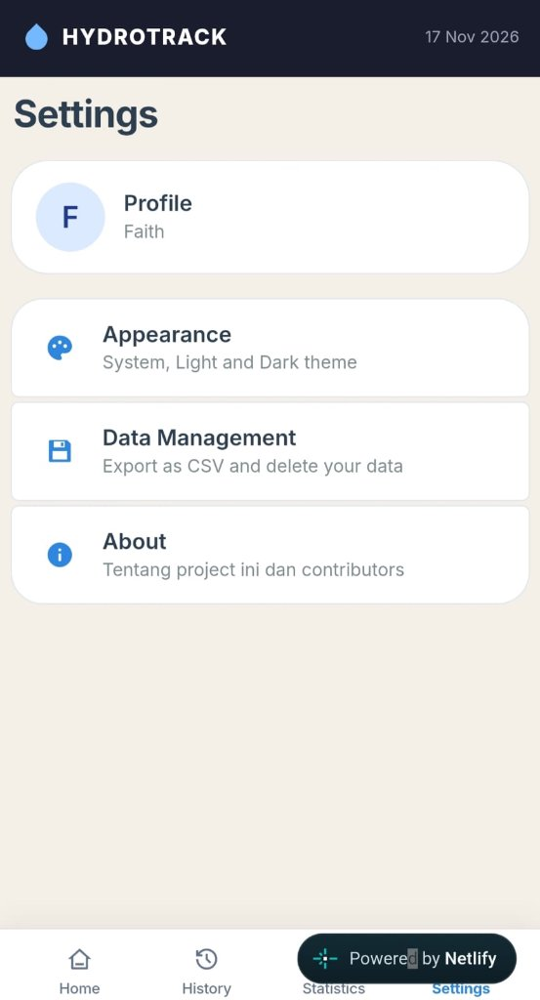

# 💧 HydroTrack — Daily Water Intake Tracker

**HydroTrack** adalah aplikasi web pelacak konsumsi air harian (*Daily Water Intake Tracker*) modern yang dirancang untuk membantu pengguna mencatat asupan cairan, mencapai target hidrasi harian, dan memantau kebiasaan minum melalui visualisasi data interaktif.

Proyek ini dibangun menggunakan **HTML5**, **CSS3 Murni (Custom Properties, Flexbox, Grid)**, dan **Vanilla JavaScript (ES6+)** tanpa *framework* CSS/JS eksternal, dengan penyimpanan data lokal berbasis `localStorage`.

---

## ✨ Fitur Utama

### 1. 🏠 Home (Dashboard Utama — `index.html`)
- **Top Header & Sapaan Dinamis:** Menampilkan sapaan waktu otomatis (*Good Morning*, *Good Afternoon*, *Good Evening*, *Good Night*) yang terpersonalisasi dengan nama pengguna, indikator tanggal hari ini, serta chip profil interaktif yang terhubung langsung ke pengaturan.
- **Progress Target Harian:** Menampilkan total asupan cairan hari ini dibandingkan target harian (`ml` dan persentase `%`) melalui *progress bar* dinamis.
- **Quick Log Menu Minuman & Kustomisasi Wadah:**
  - **Pills Kategori Minuman:** Pilihan 9 kategori minuman utama (*Water*, *Coffee*, *Energy Drink*, *Fruit Juice*, *Milk*, *QRS*, *Soft Drink*, *Sports Drink*, *Tea*) dengan ikon visual khas.
  - **Tombol Takaran Cepat:** Tombol wadah dengan scroll horizontal halus (mendukung *mouse wheel*, *drag-to-scroll*, dan *touch swipe*) untuk wadah standar (*Small Cup 175 ml*, *Medium Glass 200 ml*, *Large Glass 300 ml*, *Water Bottle 500 ml*, *Large Bottle 1.000 ml*).
  - **Fitur + Add Container:** Pengguna dapat menambahkan ukuran wadah kustom sendiri dengan pilihan ikon wadah SVG kustom (*Cup*, *Glass*, *Mug*, *Bottle*).
- **Visualisasi Botol Hidrasi Interaktif:** Animasi level air dan efek gelombang dinamis di dalam botol yang bergerak naik secara *real-time* mencerminkan persentase capaian target hidrasi.
- **Recent Entries (Catatan Hari Ini):** Daftar riwayat minum hari ini lengkap dengan aksi **Edit** (ubah takaran wadah, jenis minuman, jam konsumsi, dan volume) serta **Delete** langsung di tempat.
- **Hydration Tips & Motivational Banner:** Banner pengingat minum dengan opsi tutup dan tips hidrasi harian yang informatif.

### 2. 📅 History (Riwayat Konsumsi — `riwayat.html`)
- **3 Mode Analisis Waktu (Segmented Tabs):**
  - **Weekly:** Grafik batang 7 hari (Chart.js) dengan garis batas target harian dan lencana trofi emas (🏆) saat target tercapai.
  - **Monthly:** Kalender bulanan interaktif dengan penanda status hari aktif dan tanggal pencapaian target.
  - **Yearly:** *Heatmap* kontribusi aktivitas hidrasi 365 hari penuh dengan 4 tingkatan gradasi warna.
- **Kartu Ringkasan Metrik:** Menampilkan ringkasan metrik periode terpilih: *Total Intake*, *Daily Average*, *Best Day*, *Days Tracked*, *Goals Met*, dan *Success Rate*.
- **Rincian Catatan Per Tanggal & Manajemen Data:** Klik tanggal mana pun pada grafik mingguan atau kalender bulanan untuk meninjau, mengedit, atau menghapus catatan minum pada hari tersebut.

### 3. 📊 Statistics (Analisis & Statistik — `analisis.html`)
- **4 Kartu Metrik Utama:** Kartu ringkasan *Total Intake*, *Daily Average*, *Success Rate*, dan *Days Tracked* dengan aksen warna indikator status.
- **Overview Kebiasaan Hidrasi (8 Metrik Pola):** Analisis kebiasaan mendalam mencakup *Current Streak*, *Success Rate*, *Days Tracked*, *Average Interval*, *Average Drink Size*, *Largest Drink*, *First Drink*, dan *Last Drink*.
- **Beverage Breakdown:** Grafik *Doughnut* (Chart.js) dengan ringkasan total volume di tengah grafik serta rincian persentase dan volume per jenis minuman yang dikonsumsi.
- **Container Usage:** Tabel ringkasan statistik frekuensi dan total volume penggunaan masing-masing jenis takaran wadah minum (*Container*, *Volume*, *Uses*).

### 4. ⚙️ Settings (Pengaturan & Profil — `pengaturan.html`)
- **Desain Responsif Dual-Arsitektur:**
  - **Desktop (> 1024px):** Layout grid terpadu yang menampilkan profil, target harian, tema, dan manajemen data secara selaras dengan top header 72px.
  - **Mobile & Tablet (≤ 1024px):** Desain adaptif berbasis **Material 3 Expressive UI** dengan kartu hero profil, avatar dinamis, dan sub-view navigasi bertingkat.
- **Appearance (Tema Tampilan 3-Pill):** Kontrol segmented 3 pilihan (**⚙ System**, **☼ Light**, **☾ Dark**) yang fleksibel, otomatis sinkron dengan preferensi perangkat, dan memenuhi standar kontras WCAG AA.
- **Profile & Daily Goals:**
  - Kartu profil dengan avatar inisial dinamis, sapaan waktu, dan metrik kilat (*Today's Entries*, *Days Tracked*, *Today's Goal*).
  - Pengaturan personal (Nama Panggilan & Gender).
  - Penyesuaian target air harian (*Daily Water Goal*) dengan opsi cepat `1.5 L`–`3 L` serta faktor pengali tingkat aktivitas harian (*Sedentary* hingga *Very Active*).
- **Data Management & Backup:**
  - **Export as CSV:** Unduh seluruh rekaman riwayat konsumsi air ke dalam format `.csv` untuk dibuka di Microsoft Excel atau Google Sheets.
  - **Pilihan Penghapusan Data:** Opsi *Delete entries before date* (hapus catatan sebelum tanggal tertentu), *Delete local data only* (hapus log riwayat tanpa mereset profil), dan *Delete everything* (reset pabrik penuh).
- **About & Contributors:** Informasi versi aplikasi, arsitektur teknologi, dan profil tim pengembang.

### 5. 🌊 Welcome & Onboarding Setup (`welcome.html`)
- **Interactive Multi-Step Wizard:** Alur setup 8 langkah interaktif bagi pengguna baru atau setelah melakukan reset pabrik:
  1. **Welcome Screen:** Sambutan dan perkenalan fitur personalisasi hidrasi.
  2. **Tell Us About Yourself:** Pemilihan identitas gender (*Male*, *Female*, *Prefer not to say*).
  3. **Age Group:** Penentuan kelompok usia (*18–30*, *31–50*, *51–60*, *60+ years*).
  4. **Activity Level:** Penyesuaian intensitas kegiatan harian (*Sedentary*, *Light*, *Moderate*, *Active*).
  5. **Schedule (Wake & Sleep Time):** Waktu bangun dan tidur dengan kalkulator otomatis durasi jam aktif harian (*Awake duration*).
  6. **Complete Your Profile:** Pendaftaran nama panggilan pengguna dengan avatar inisial dinamis dan counter karakter.
  7. **Personalized Goal Review:** Algoritma rekomendasi target air harian (*Daily Water Goal*) dan interval pengingat minum (*Reminder Interval*) yang dihitung secara presisi.
  8. **You're All Set!:** Layar perayaan dengan tombol *Start hydrating* untuk menyimpan konfigurasi ke `localStorage` dan langsung dialihkan ke Dashboard utama.

### 6. 📱 Desain UI/UX & Responsivitas Antarmuka
- **Desktop Continuous Header Line:** Garis pembatas horizontal kontinu selebar layar pada ketinggian `y = 72px` yang menyatu presisi antara logo sidebar dan top header di seluruh halaman.
- **Interactive Profile Chip:** Tombol profil di sudut kanan atas header desktop yang menampilkan avatar, nama, peran pengguna, dan pintasan langsung ke menu pengaturan.
- **Bottom Navigation Bar (Mobile):** Akses cepat 4 menu utama (*Home*, *History*, *Statistics*, *Settings*) yang tersemat rapi di bagian bawah layar perangkat seluler.
- **Proteksi Anti-Layout Shift:** Optimasi viewport mobile dengan penguncian scrollbar internal agar transisi antar-halaman bebas dari kedipan (*flicker*) atau lonjakan address bar browser.

---

## 🚀 Cara Menjalankan Aplikasi

Aplikasi ini berjalan sepenuhnya di sisi klien (*client-side*) dan tidak memerlukan instalasi *database* atau *backend server*.

### Opsi 1: Buka Langsung di Browser
1. **Clone** atau unduh repositori ini:
   ```bash
   git clone https://github.com/Chief123-cod/hydrotrack.git
   cd hydrotrack
   ```
2. Klik dua kali file `index.html` untuk membukanya langsung di browser (Google Chrome, Microsoft Edge, Firefox, atau Safari).

### Opsi 2: Menggunakan VS Code Live Server (Disarankan)
1. Buka folder `hydrotrack` di **Visual Studio Code**.
2. Pasang ekstensi **Live Server** (oleh Ritwick Dey).
3. Klik kanan pada `index.html` lalu pilih **"Open with Live Server"**.
4. Aplikasi akan terbuka otomatis di `http://127.0.0.1:5500/index.html`.

### Opsi 3: Menggunakan Terminal (Python / Node.js)
```bash
# Menggunakan Python 3
python -m http.server 8080

# Atau menggunakan Node.js
npx serve .
```
Kemudian buka `http://localhost:8080` di browser Anda.

---

## 🖼️ Screenshot Aplikasi

### Tampilan Desktop
| Home (`index.html`) | History (`riwayat.html`) |
| :---: | :---: |
|  |  |

| Statistics (`analisis.html`) | Settings (`pengaturan.html`) |
| :---: | :---: |
|  |  |

### Tampilan Mobile (Responsive)
| Home Mobile | History Mobile | Statistics Mobile | Settings Mobile |
| :---: | :---: | :---: | :---: |
|  |  |  |  |

---

## 📂 Struktur Direktori

```text
hydrotrack/
├── img/                # Screenshot aplikasi untuk dokumentasi
│   ├── home-desktop.png
│   ├── history-desktop.png
│   ├── statistics-desktop.png
│   ├── settings-desktop.png
│   ├── home-mobile.png
│   ├── history-mobile.png
│   ├── statistics-mobile.png
│   └── settings-mobile.png
├── index.html          # Halaman utama (Dashboard, Quick Log, Botol Hidrasi, Recent Entries)
├── riwayat.html        # Halaman riwayat (Weekly Bar, Monthly Calendar, Yearly Heatmap)
├── analisis.html       # Halaman statistik (Overview 8 Metrik, Beverage Breakdown, Container Usage)
├── pengaturan.html     # Halaman pengaturan (Profile, Appearance, Data Management, About)
├── welcome.html        # Halaman onboarding & wizard pendaftaran profil baru
├── AGENTS.md           # Pedoman, batasan teknis & protokol kerja AI Coding Assistant
├── css/
│   ├── style.css       # Variabel CSS global (Light & Dark Mode), reset, sidebar, bottom-nav
│   ├── components.css  # Styling komponen kartu, botol, tabel, grafik, modal, dan form
│   ├── responsive.css  # Media queries untuk Desktop, Tablet (<= 1024px, <= 768px), dan Mobile (<= 640px)
│   └── welcome.css     # Styling responsif halaman onboarding, kartu opsi, dan animasi gelombang
├── js/
│   ├── storage.js      # Manajemen data LocalStorage (CRUD log minum, wadah, pengaturan, ekspor CSV)
│   ├── ui.js           # Manipulasi DOM, rendering komponen, kalkulasi metrik, modal, dan toast
│   ├── chart.js        # Konfigurasi dan pembaruan grafik Chart.js (Doughnut & Bar Chart)
│   ├── app.js          # Event listener utama, navigasi, drag-to-scroll, dan kontrol interaksi
│   └── welcome.js      # Logika multi-step onboarding, kalkulator target air & interval pengingat
└── docs/
    ├── PRD.md          # Dokumen Spesifikasi Kebutuhan Produk
    └── WORKFLOW.md     # Standar Operasional Prosedur Pengembangan
```

---

## 🛠️ Teknologi yang Digunakan

- **HTML5 Semantik** (`<header>`, `<aside>`, `<nav>`, `<main>`, `<section>`)
- **CSS3 Murni** (*CSS Custom Properties*, *Flexbox*, *CSS Grid*, *Media Queries*, *Keyframe Animations*)
- **Vanilla JavaScript (ES6+)** (*Modular IIFE Pattern*, *DOM Manipulation*, *LocalStorage API*, *Blob CSV Export*)
- **[Chart.js v4.4.7](https://www.chartjs.org/)** — Visualisasi grafik proporsi minuman
- **[Remix Icon v4.6.0](https://remixicon.com/)** — Ikonografi antarmuka
- **[Google Fonts (Inter)](https://fonts.google.com/specimen/Inter)** — Tipografi utama

---

## 👥 Tim Pengembang (Contributors)

1. **Pontoh, Faith** — *Project Lead & UI/UX Designer*
2. **Jose Angelo Raphael Ratumbanua** — *Frontend & Core Logic Developer*
3. **Camelia Anggreita Tumimomor** — *Interface Design & Analytics*
4. **Seril Sevanya Wanta** — *Responsive Layout & QA Specialist*
