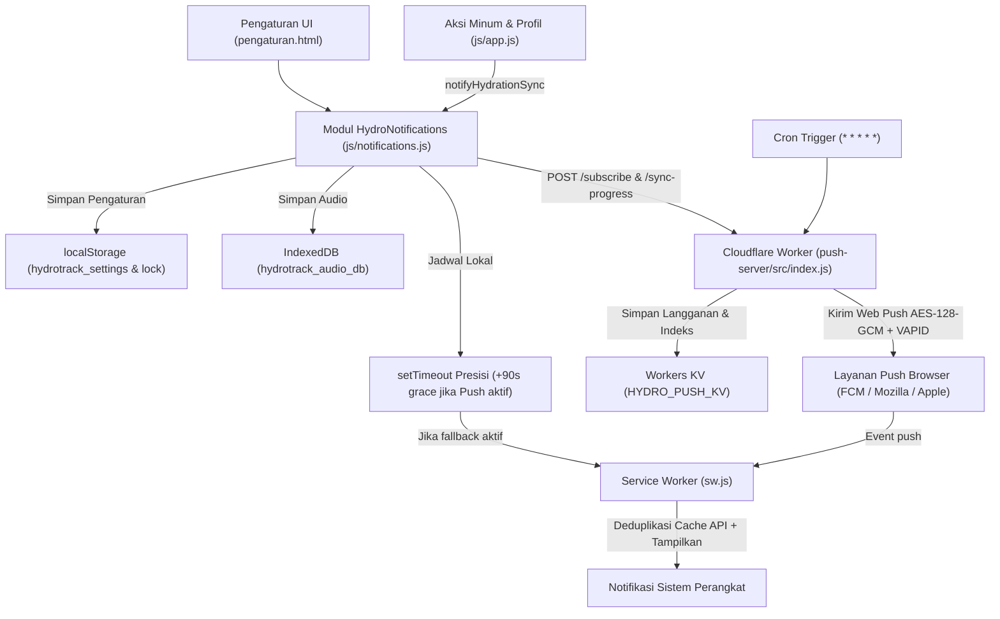

# Laporan Dokumentasi Fitur Notifikasi (HydroTrack)

## 1. Informasi Dokumen & Ringkasan Fitur Notifikasi

- **Nama Proyek:** HydroTrack (Pelacak Asupan Air Harian)
- **Cakupan Dokumen:** Subsistem Notifikasi Pengingat Hidrasi (Frontend UI, Penjadwal Lokal, Audio, Service Worker/PWA, dan Backend Web Push)
- **Tujuan Fitur:** Membantu pengguna menjaga kebiasaan minum air secara rutin melalui pengingat otomatis di peramban/perangkat, baik saat aplikasi sedang dibuka (pengingat lokal) maupun saat tab ditutup atau layar terkunci (Web Push latar belakang).
- **Stack Teknologi:**
  - **Frontend:** HTML5, CSS3 murni (Custom Properties, Flexbox, Grid), dan Vanilla JavaScript (ES6+).
  - **Browser & PWA API:** Web Notification API, Push API (`PushManager`), Service Worker API, IndexedDB, Cache API, Web Audio API, dan Web App Manifest (`manifest.json`).
  - **Backend Push Server:** Cloudflare Workers, Cloudflare Workers KV (`HYDRO_PUSH_KV`), dan Cloudflare Cron Triggers (`* * * * *`), menggunakan Web Crypto API bawaan untuk tanda tangan VAPID ES256 JWT (RFC 8292) serta enkripsi payload `aes128gcm` (RFC 8291 / RFC 8188) tanpa dependensi API berbayar.

---

## 2. Peta Berkas Khusus Fitur Notifikasi

| Berkas | Ukuran / Baris | Peran dalam Subsistem Notifikasi |
| :--- | :--- | :--- |
| `pengaturan.html` | Sub-view & 3 modal | Menyediakan kartu menu Notifikasi (`#menuBtnNotifications`), sub-view `#subview-notifications`, serta modal `#notifScheduleModalOverlay`, `#notifSoundModalOverlay`, dan `#notifTestModalOverlay`. |
| `js/notifications.js` | 3.919 baris | Modul utama `HydroNotifications`: mengelola konfigurasi, kalkulasi jadwal, penjadwal lokal, penyimpanan audio IndexedDB, pemutaran suara, pesan otomatis/kustom, langganan Web Push, tes demo, dan rendering UI. |
| `sw.js` | 410 baris | Service Worker (`hydrotrack-sw-v16`): menangani event `push`, `notificationclick`, `message`, deduplikasi slot notifikasi melalui Cache API, serta strategi cache `network-first`. |
| `manifest.json` | 27 baris | Konfigurasi PWA (`display: "standalone"`, `start_url: "./index.html"`, ikon `img/icon-192.png` dan `img/icon-512.png`). |
| `js/storage.js` | Integrasi state | Menyimpan objek default `notifications` di dalam `hydrotrack_settings`, melakukan penggabungan mendalam (*deep merge*), dan memanggil `HydroNotifications.resetNotificationAudioData()` saat reset penuh. |
| `js/app.js` | Integrasi siklus hidup | Menjalankan `HydroNotifications.init()`, menginisialisasi UI pengaturan, serta memanggil `notifyHydrationSync()` (`HydroNotifications.syncHydrationProgress()`) setiap log minum atau profil berubah. |
| `index.html`, `riwayat.html`, `analisis.html` | Script lintas halaman | Memuat `js/notifications.js` dan menyediakan `#toastContainer` agar penjadwal lokal serta sinkronisasi ke Push Server tetap aktif di seluruh halaman. |
| `css/components.css` & `css/responsive.css` | Styling & responsif | Mengatur tampilan kartu pengaturan notifikasi, sakelar (*switch*), modal pop-up, daftar pesan kustom, panduan Android, tema terang/gelap, serta tata letak tablet (`<= 1024px`) dan mobile (`<= 768px`). |
| `push-server/src/index.js` | 1.144 baris | Backend Cloudflare Worker: menyediakan endpoint API Web Push dan pemrosesan jadwal Cron tiap menit (`* * * * *`). |
| `push-server/src/webpush.js` | 291 baris | Implementasi VAPID ES256 JWT dan enkripsi Web Push `aes128gcm` berbasis Web Crypto API. |
| `push-server/generate-vapid.mjs` | 48 baris | Skrip CLI pembuat pasangan kunci VAPID ECDSA P-256 (`VAPID_PUBLIC_KEY` dan `VAPID_PRIVATE_KEY`). |
| `push-server/wrangler.toml` | 15 baris | Konfigurasi Worker `hydrotrack-push`, jadwal Cron `* * * * *`, dan binding KV `HYDRO_PUSH_KV`. |

---

## 3. Antarmuka Pengguna (Halaman Pengaturan > Notifikasi)

Sub-halaman Notifikasi (`#subview-notifications` di `pengaturan.html`) diakses dari menu utama Pengaturan melalui tombol `#menuBtnNotifications` yang menampilkan ringkasan status aktif/nonaktif secara langsung (`#menuNotificationsSub`).

### 3.1 Kartu Utama: Pengingat Hidrasi
- Menampilkan judul **Pengingat Hidrasi** dengan sakelar master `#notifEnabledToggle` (`role="switch"`).
- Saat diaktifkan untuk pertama kali, aplikasi memeriksa dukungan platform (termasuk kebutuhan instalasi ke Layar Utama pada iOS/iPadOS) dan meminta izin `Notification.requestPermission()`.
- Saat dimatikan, penjadwal lokal dihentikan (`clearLocalTimer()`) dan perubahan status segera dikirim ke Push Server (`queueScheduleSyncToServer({ immediate: true })`).

### 3.2 Kartu Pemicu & Modal Jadwal & Interval (`#notifScheduleModalOverlay`)
- **Mode Jadwal:**
  - `Jadwal Tetap` (`fixed`): mengirim pengingat berdasarkan slot jam rutin dari jam mulai hingga jam selesai.
  - `Mode Pintar` (`smart`): menghitung waktu pengingat berikutnya berdasarkan waktu catatan minum terakhir pada hari yang sama ditambah interval.
- **Jam Aktif:** input `#notifStartTime` (default `07:00`) dan `#notifEndTime` (default `21:00`). Validasi memastikan jam selesai lebih besar daripada jam mulai.
- **Interval Pengingat Cepat:** lima tombol preset (`data-notif-interval`) yaitu `30 Menit`, `1 Jam` (`60`), `1,5 Jam` (`90`), `2 Jam` (`120`, default), dan `3 Jam` (`180`).
- **Interval Kustom:** input jam (`0` sampai `8`) dan menit (`0` sampai `59`) melalui tombol `#btnApplyCustomInterval`. Rentang valid di klien adalah `15` hingga `480` menit (8 jam).
- **Jeda Otomatis Target Tercapai:** kotak centang `#notifPauseGoalMet` (aktif secara default) untuk menjeda pengingat hingga esok hari bila target harian sudah mencapai 100%.
- **Perkiraan Jadwal Hari Ini (`#notifScheduleTimeline`):** menampilkan daftar chip slot waktu dengan penanda visual untuk slot yang sudah lewat (`is-past`), slot berikutnya (`is-next`), atau keterangan jeda ketika target harian sudah terpenuhi.

### 3.3 Kartu Pemicu & Modal Nada Dering & Suara (`#notifSoundModalOverlay`)
- **Sumber Suara:**
  - `Default` (`#soundTypeDefault`): menggunakan nada notifikasi bawaan sistem perangkat.
  - `Custom` (`#soundTypeUpload`, nilai `custom-upload`): membuka panel `#soundUploadPanel` untuk memilih berkas audio dari perangkat (`.mp3`, `.wav`, `.ogg`, `.m4a`, `.aac`, `.webm`, `.flac`, `.opus`, batas ukuran maksimal `5 MB`).
- **Kontrol Audio Kustom:** menampilkan nama file tersimpan (`#customAudioName`), tombol pratinjau putar (`#btnPreviewCustomAudio`), dan tombol hapus (`#btnRemoveCustomAudio`).
- **Panduan Android (`details.notif-os-guide`):** panduan ringkas 3 langkah untuk mengatur suara saluran notifikasi situs HydroTrack di sistem Android (pengaturan 1 kali) agar nada kustom tetap berbunyi ketika aplikasi ditutup dari *recent apps*.

### 3.4 Kartu Pemicu & Modal Tes Notifikasi (`#notifTestModalOverlay`)
- **Mode Uji Coba:**
  - `Tes Sekarang` (`#btnDemoTestNow`): mengirim notifikasi instan dan langsung memutar nada dering kustom (jika dipilih) untuk memeriksa fungsi tampilan dan suara.
  - `Tutup Aplikasi` (`#btnDemoTestDelayed`): menjadwalkan push demo tertunda selama `10 detik` melalui Cloudflare Worker dan timer cadangan Service Worker agar pengguna dapat menekan Home atau mengunci layar untuk menguji notifikasi latar belakang. Tes demo menggunakan tag unik (`hydrotrack-test-<timestamp>`) dan terisolasi sehingga tidak mengubah jadwal pengingat utama di Workers KV maupun `localStorage`.
- **Kelola Pesan Notifikasi (CRUD):**
  - Formulir `#inputNotifMsgTitle` (maksimal `80` karakter) dan `#inputNotifMsgBody` (maksimal `220` karakter) untuk menambah dan mengedit pesan.
  - Daftar `#notifCustomMsgList` menampung hingga `20` pesan kustom. Pengguna dapat memilih pesan aktif untuk uji coba, mengedit, atau menghapus pesan.
  - Tersedia 2 pesan awal (*starter*) secara default: **"Waktunya Minum Air!"** dan **"Jangan Lupa Hidrasi"**.

### 3.5 Koneksi Push Server Latar Belakang
- Kartu konfigurasi manual URL Push Server telah disembunyikan dari tampilan UI Pengaturan (sejak commit `029ef32`) agar antarmuka tetap ringkas.
- Aplikasi secara otomatis menghubungkan perangkat ke `DEFAULT_PUSH_SERVER_URL` (`https://hydrotrack-push.faithpontoh182.workers.dev`) di latar belakang saat izin notifikasi telah diberikan.

---

## 4. Arsitektur & Alur Kerja Pengiriman Notifikasi

### 4.1 Penjadwalan Hibrida (Lokal & Server)
1. **Penjadwal Lokal (`scheduleLocalTimer`):**
   - Menghitung slot berikutnya lewat `computeNextReminder()` dan memasang satu `setTimeout` tunggal yang diperbarui otomatis saat pengguna berpindah tab atau membuka kembali aplikasi (`visibilitychange` dan `focus`).
   - Saat Push Server terhubung dan perangkat dalam keadaan online, timer lokal diberi masa tenggang cadangan `90 detik` (`fallbackGraceMs = 90000`) agar tidak bertabrakan dengan push dari server.
   - Pada `handleLocalTimerFire()`, bila timer tertunda lebih dari `15 detik` karena tab sempat dibekukan sistem (`(nowMs - expectedFireMs) > 15000`), notifikasi tidak dimunculkan secara mendadak saat aplikasi dibuka kembali; penjadwal langsung menghitung ulang slot berikutnya (`reconcileTimerOnWake()`).
2. **Penjadwal Server (`scheduled` Cron `* * * * *`):**
   - Berjalan setiap menit di Cloudflare Workers.
   - Menghitung tanggal dan jam lokal pengguna memakai IANA `timeZone` (`Intl.DateTimeFormat`) dengan cadangan `timezoneOffsetMinutes`.
   - Menganggap `todayTotal = 0` jika tanggal lokal pengguna telah berganti hari dibandingkan `profile.todayDate`.
   - Melewati pengiriman jika pengingat nonaktif (`disabled`), target harian sudah tercapai saat opsi jeda aktif (`goal_met`), atau waktu saat ini berada di luar rentang jam mulai dan jam selesai (`outside_window`).

### 4.2 Mekanisme Anti-Duplikasi 3 Lapis
1. **Lapisan Server (`push-server/src/index.js`):**
   - Pencocokan menit persis (`currentMin === candidate`) sehingga Cron menit berikutnya (`t+1` atau `t+2`) tidak mengirim ulang meski replikasi KV belum serentak.
   - Pengecekan `record.lastNotifiedSlot === slotKey` dan cooldown `50 detik` terhadap `record.lastSentAt`.
   - Peta memori *isolate* `recentIsolateSentSlots` dengan jendela deduplikasi `10 menit` (dibatasi maksimal 500 entri di memori).
2. **Lapisan Service Worker (`sw.js`):**
   - Menyimpan status pengingat terakhir di Cache API (`hydrotrack-notif-state`, URL internal `/__hydrotrack_last_reminder_slot__`).
   - Jika `slotKey` yang sama masuk dalam rentang `10 menit` atau pengingat baru masuk dalam jeda kurang dari `45 detik`, event `push` menampilkan notifikasi secara senyap (`renotify: false`, `silent: true`, tanpa getar) agar tetap memenuhi syarat `userVisibleOnly` browser Chrome tanpa mengganggu pengguna.
3. **Lapisan Klien (`js/notifications.js`):**
   - Mencatat kunci pengingat terakhir pada `localStorage` (`hydrotrack_last_notif_lock`) dengan batas duplikasi slot `10 menit` dan cooldown `55 detik`.
   - Saat `HYDRO_PUSH_RECEIVED` diterima dari Service Worker, `lastPushReceivedAt` diperbarui sehingga fallback timer lokal otomatis dilewati apabila push server sudah tiba dalam `3 menit` terakhir (`180000 ms`).

---

## 5. Sistem Pesan Notifikasi (Kustom & Otomatis)

### 5.1 Pesan Kustom Pengguna
- Jika `customMessages` memiliki minimal 1 entri, baik klien (`buildReminderMessage`) maupun server (`buildReminderPayload`) memilih pesan secara bergilir menggunakan rumus indeks langkah waktu (`slotStep % customMessages.length`).
- Sinkronisasi daftar `customMessages` dikirim ke server melalui payload `/subscribe` sehingga pesan kustom tetap tampil meskipun aplikasi sedang tertutup.

### 5.2 Generator Pesan Otomatis Bahasa Indonesia (Zero-Token)
- Jika pengguna menghapus seluruh pesan kustom (`customMessages` kosong), sistem menggunakan generator pesan dinamis bawaan tanpa API AI berbayar.
- Pesan menyesuaikan konteks waktu lokal (`pagi`, `siang`, `sore`, `malam`), nama pengguna, total konsumsi air hari ini (`ml`), target harian (`ml`), sisa kebutuhan (`ml`), serta kategori persentase capaian (`0%`, `< 40%`, `40% - 79%`, `80% - 99%`, dan `>= 100%`).

---

## 6. Penyimpanan Data & Sinkronisasi Lintas Halaman

- **`localStorage` (`hydrotrack_settings.notifications` & `hydrotrack_notification_settings`):**
  Menyimpan `enabled`, `mode` (`fixed` / `smart`), `startTime`, `endTime`, `intervalMinutes`, `pauseWhenGoalMet`, `soundType`, `defaultSoundId`, `customAudioName`, `customVoiceName`, `customVoiceDuration`, `customMessages`, `customMessagesInitialized`, `selectedDemoMessageId`, `pushServerUrl`, `pushConnected`, `lastScheduledAt`, dan `lastNotifiedSlot`.
- **`localStorage` (`hydrotrack_last_notif_lock`):**
  Menyimpan `{ slotKey, at }` untuk penguncian anti-duplikasi di sisi browser.
- **`IndexedDB` (`hydrotrack_audio_db` versi `1`, store `ringtones`):**
  Menyimpan file biner audio (`Blob`), nama file, tipe MIME, durasi, dan waktu pembaruan pada kunci `custom-upload` agar tidak membebani kuota `localStorage`.
- **Sinkronisasi Lintas Halaman (`js/app.js`):**
  Seluruh halaman utama (`index.html`, `riwayat.html`, `analisis.html`, `pengaturan.html`) menjalankan `HydroNotifications.init()`. Setiap penambahan, pengeditan, penghapusan catatan minum, maupun perubahan nama atau target harian memanggil `notifyHydrationSync()`, yang menjalankan `syncHydrationProgress()` dengan debounce `250 ms` dan opsi `keepalive: true`. Saat halaman disembunyikan atau ditinggalkan (`visibilitychange` hidden / `pagehide`), `flushPendingServerSyncs()` segera mengirim antrean sinkronisasi yang tertunda.
- **Pembersihan Reset Data (`js/storage.js`):**
  Saat pengguna memilih **Hapus semua data**, `Storage.clearAllData()` memanggil `HydroNotifications.resetNotificationAudioData()` untuk menghapus pengaturan notifikasi, mengosongkan `IndexedDB` audio, dan memutus langganan `PushManager`.

---

## 7. Backend Cloudflare Workers Push Server (`push-server/`)

### 7.1 Daftar Endpoint API (`push-server/src/index.js`)

| Metode | Path | Fungsi dan Perilaku Utama |
| :--- | :--- | :--- |
| `GET` | `/` atau `/health` | Mengembalikan status layanan `hydrotrack-push`, kesiapan kunci VAPID (`vapidConfigured`), koneksi KV (`kvConfigured`), dan timestamp. |
| `GET` | `/vapid-public-key` | Mengembalikan `{ publicKey }` untuk proses `PushManager.subscribe()` di browser. |
| `POST` | `/subscribe` | Memvalidasi objek `subscription`, menormalisasi jadwal dan profil hidrasi, menyimpan record ke KV (`sub:<sha256(endpoint)>`, TTL 90 hari), memperbarui indeks `meta:sub_index`, serta mengembalikan perkiraan `nextReminderAt` dan `nextReminderLocal`. |
| `POST` | `/sync-progress` | Memperbarui `userName`, `dailyGoal`, `todayTotal`, `todayDate`, dan `lastDrinkAt` tanpa menimpa pengaturan jadwal. Jika record di KV belum ada (`HTTP 404`), klien otomatis mendaftar ulang lewat `/subscribe`. |
| `POST` | `/unsubscribe` | Menghapus key langganan dari KV dan menghapus entri terkait dari `meta:sub_index`. |
| `POST` | `/test-push` | Mengirim tes notifikasi langsung (`delaySeconds = 0`) atau tertunda maksimal `25 detik` menggunakan `ctx.waitUntil`. Header VAPID dan enkripsi payload disiapkan sebelum respons `200` dikirim, memakai tag unik `hydrotrack-test-<timestamp>` tanpa header `Topic`. |

### 7.2 Keamanan Kriptografi Web Push (`push-server/src/webpush.js`)
- `createVapidAuthHeader()`: membuat token JWT ES256 (`ECDSA` kurva P-256 dengan `SHA-256`) berdurasi kedaluwarsa `12 jam` (`VAPID_EXPIRY_SECONDS = 43200`).
- `encryptWebPushPayload()`: mengenkripsi payload notifikasi sesuai RFC 8291 dan RFC 8188 (`aes128gcm`) menggunakan pertukaran kunci `ECDH` P-256, derivasi kunci `HMAC-SHA-256` (HKDF), dan enkripsi `AES-GCM` 128-bit dengan ukuran record `4096` byte.
- `generate-vapid.mjs`: menghasilkan pasangan kunci P-256 terformat `base64url` untuk disimpan sebagai Cloudflare Worker secrets.

### 7.3 Efisiensi Kuota Paket Gratis Cloudflare Workers
- **Indeks Tunggal `meta:sub_index`:** Cron 1 menit menggunakan `KV.get(SUB_INDEX_KEY)` (memanfaatkan kuota 100.000 pembacaan KV/hari) daripada `KV.list` (yang terbatas 1.000 operasi/hari).
- **Pemrosesan Batch & Hemat Penulisan:** Cron memproses langganan dalam batch berukuran `5` (`CRON_BATCH_SIZE = 5`) dan hanya menulis ke KV (`KV.put`) ketika pengingat benar-benar terkirim, saat pengaturan berubah, atau saat progres hidrasi disinkronkan.
- **Pembersihan Otomatis:** Langganan yang membalas `HTTP 404` atau `410` dari layanan push otomatis dihapus dari KV dan `meta:sub_index`.

---

## 8. Service Worker (`sw.js`), Audio Latar Belakang & Dukungan PWA

- **Strategi Cache (`hydrotrack-shell-v16`):** menggunakan pendekatan *network-first* dengan opsi `cache: 'no-cache'` untuk navigasi serta file `.html`, `.js`, `.css`, dan `.json`, lalu jatuh kembali ke cache lokal bila perangkat offline.
- **Event `notificationclick`:**
  - Tombol aksi `Nanti` (`dismiss`) langsung menutup notifikasi.
  - Ketukan pada notifikasi atau tombol `Catat Minum` (`open`) memfokuskan jendela HydroTrack yang sedang terbuka (atau membuka `index.html?from=notification` bila aplikasi tertutup) dan mengirim pesan `HYDRO_NOTIFICATION_CLICKED`.
- **Event `message` di Service Worker:** melayani pesan `SHOW_LOCAL_NOTIFICATION`, `SCHEDULE_SW_DELAYED_TEST` (cadangan tes 10 detik yang otomatis batal jika push server sudah tiba lebih dulu), `SKIP_WAITING`, dan `PING`.
- **Pemutaran Audio Latar Belakang (`js/notifications.js`):**
  - `startSilentAudioKeepAlive()`: menjaga sesi Web Audio tetap aktif sementara selama uji coba tertunda agar nada kustom berpeluang diputar saat layar dikunci atau aplikasi diminimalkan.
  - `playSoundWithRetryOnGesture()` & `handleIncomingNotificationParam()`: memutar ulang nada kustom ketika pengguna mengetuk notifikasi (`?from=notification`) atau pada sentuhan pertama jika browser memblokir *autoplay*.
- **Dukungan PWA Lintas Perangkat:** menangkap event `beforeinstallprompt`, mendeteksi mode *standalone* (`display-mode: standalone` / `navigator.standalone`), serta mendeteksi perangkat iOS/iPadOS yang belum terinstal ke Layar Utama (`needsIosInstall`).

---

## 9. Riwayat Pengembangan Fitur Notifikasi

Berdasarkan riwayat commit repositori, pengembangan fitur notifikasi berjalan melalui tujuh tahapan utama:

| Commit | Ringkasan Perubahan |
| :--- | :--- |
| `20e310a` | Implementasi awal fitur pengingat hidrasi (`js/notifications.js`), Service Worker (`sw.js`), manifes PWA (`manifest.json`), serta server Web Push Cloudflare Workers (`push-server/`). |
| `c65fb9d` | Perbaikan pengiriman push latar belakang, pembaruan cache Service Worker, dan *keep-alive* audio di latar belakang. |
| `029ef32` | Menyembunyikan kartu pengaturan URL Push Server dari UI dan menghubungkan Push Server secara diam-diam di latar belakang. |
| `6268f14` | Penyempurnaan kartu notifikasi, konversi panel pengaturan menjadi modal pop-up, mekanisme anti-duplikasi push, dan tes demo push. |
| `067abec` | Penambahan modal Tes Notifikasi (uji tutup aplikasi & nada dering), CRUD pesan notifikasi kustom, serta perbaikan scroll modal bersarang. |
| `1d42b3d` | Penambahan panduan ringkas pemasangan nada dering kustom Android pada panel suara Custom. |
| `225113a` | Peningkatan keandalan tes push tutup aplikasi 10 detik (pre-sign VAPID & pre-encrypt payload sebelum `ctx.waitUntil`), penggunaan tag tes unik, dan indeks langganan `meta:sub_index` di KV. |

---

## 10. Batasan Platform & Catatan Teknis

- **Nada Dering Kustom Saat Aplikasi Ditutup Paksa (Android):** Web Push standar pada browser mobile tidak dapat langsung membundel file audio kustom dari `IndexedDB` ketika proses browser ditutup sepenuhnya dari *recent apps*. Oleh karena itu, modal **Nada Dering & Suara** menyertakan panduan pengaturan saluran notifikasi Android 1 kali agar sistem operasi memutar file audio pilihan pengguna secara native.
- **Penghematan Baterai Perangkat:** Beberapa perangkat Android dengan mode penghemat baterai agresif atau pembersihan paksa dari *recent apps* dapat menunda pengiriman push latar belakang beberapa detik hingga sistem mengizinkan sinkronisasi jaringan.
- **Dukungan iOS / iPadOS:** Notifikasi Web dan Web Push di Safari iOS/iPadOS hanya aktif setelah pengguna menambahkan HydroTrack ke Layar Utama (*Add to Home Screen*) dan membukanya dalam mode *standalone*.
- **Status Kode Internal Audio di `js/notifications.js`:** Di dalam `js/notifications.js` masih terdapat fungsi internal sintesis nada Web Audio (`water-drop`, `soft-bell`, `fresh-chime`, `gentle-pulse`) dan perekam suara `MediaRecorder` (maksimal `15 detik`, key `custom-voice`), namun antarmuka modal di `pengaturan.html` saat ini disederhanakan menjadi dua pilihan utama yaitu **Default** (mengikuti sistem perangkat) dan **Custom** (unggahan file audio perangkat).
